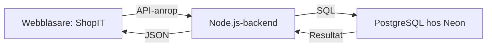

# Visa ShopIT-databasen för en klasskompis

En genomgång på ungefär 10–15 minuter. Du behöver Neon-konsolen i webbläsaren. Ingen installation behövs för själva visningen.

## 1. Börja med vad ni har byggt

Säg till exempel:

> Vi har byggt databasdelen för ShopIT. PostgreSQL lagrar skolor, utrustning, annonser och köp. Neon kör databasen i molnet, så den är tillgänglig även när våra datorer är avstängda.

**Det fungerar nu:** databas, tabeller, relationer, testdata och SQL-kontroller.

**Nästa del för backendteamet:** ansluta Node.js, bygga API:et och kontrollera inloggning och behörigheter. Den nuvarande webbplatsens produktkort är ännu inte kopplade till denna databas.

Det planerade flödet är:



> Neon är platsen där databasen körs. PostgreSQL är databassystemet. SQL är språket vi använder för att ställa frågor till databasen.

## 2. Öppna rätt databas

1. Öppna [Neon Console](https://console.neon.tech) och logga in med ditt eget konto.
2. Välj ShopIT-projektet, med projekt-ID `sweet-sky-05648360`.
3. Öppna **Postgres database → SQL Editor**.
4. Välj branchen **production** och databasen som innehåller schemat **shopit**.
5. Klistra in en fråga från guiden och tryck **Run**.

Detta följer [Neons instruktioner för SQL Editor](https://neon.com/docs/get-started/query-with-neon-sql-editor).

För en visning kan du dela skärmen; klasskompisen behöver inget databaslösenord. Om personen ska arbeta själv i Neon behöver hen egen behörighet. Visa inte Connect-dialogens anslutningssträng eller innehållet i `.env.local` under skärmdelningen: där finns lösenord.

Frågorna i den här guiden läser bara data. Du kan också köra hela [visningsskriptet](demo-readonly.sql), som använder `BEGIN READ ONLY` och avslutar med `ROLLBACK`.

## 3. Förklara de fem tabellerna

| Tabell | Vad den betyder | Exempel |
| --- | --- | --- |
| `shopit.schools` | Skolor, kontaktuppgifter och faktureringsuppgifter | Demo NTI Stockholm |
| `shopit.products` | Utrustningen i en skolas inventarie, inklusive kvarvarande antal | Tre ThinkPad-datorer |
| `shopit.listings` | Annonsen för en produkt: pris, status och skapad tid | Datorerna erbjuds för 1 500 kr styck |
| `shopit.orders` | Ett köp och köparens uppgifter vid köpet | Skola B gör en beställning |
| `shopit.order_items` | Varje produkt som ingår i beställningen, med antal och styckpris | Två datorer à 1 500 kr |

`shopit` är ett **schema**: ett namnområde som samlar våra tabeller. Därför skriver vi exempelvis `shopit.products`.

**Produkt och annons är olika saker.** Produkten beskriver skolans utrustning och lager. Annonsen beskriver erbjudandet att sälja eller skänka den. Det kan finnas utrustning i inventariet som inte är annonserad.

Vår demo tillåter högst en annons per produkt. Hela produktens kvarvarande saldo erbjuds genom den annonsen. Vi har inte byggt separata saldon för flera annonser av samma produkt.

### Vad håller ihop tabellerna?

Varje rad har ett `id`, en **primärnyckel**. Vi använder UUID, alltså unika ID:n som ser ut som långa teckensträngar.

En **främmande nyckel** pekar på en rad i en annan tabell:

- `products.school_id` → skolan som äger utrustningen.
- `listings.product_id` → utrustningen som annonseras.
- `orders.buyer_school_id` → skolan som köper.
- `order_items.order_id` → beställningen som raden tillhör.
- `order_items.listing_id` → annonsen som köpet avser.
- `order_items.seller_school_id` → skolan som säljer den raden.

> Vi kopplar ihop data med ID:n. Då behöver vi inte skriva skolans namn manuellt på varje produkt, och databasen stoppar en produkt från att peka på en skola som inte finns.

## 4. Visa att testdata finns

Kör:

```sql
SELECT
    (SELECT count(*) FROM shopit.schools) AS skolor,
    (SELECT count(*) FROM shopit.products) AS produkter,
    (SELECT count(*) FROM shopit.listings) AS annonser,
    (SELECT count(*) FROM shopit.active_listings) AS synliga_annonser,
    (SELECT count(*) FROM shopit.orders) AS bestallningar;
```

Vid installationen den 20 oktober 2026 var resultatet **3 skolor, 7 produkter, 6 annonser, 6 synliga annonser och 0 beställningar**. Siffrorna kan ändras när gruppen arbetar vidare eller annonserna blir äldre.

Skolnamn, adresser och e-postadresser i seed-datan är påhittade testuppgifter.

## 5. Visa vad startsidan ska kunna hämta

Kör:

```sql
SELECT title, category, price, quantity, school_name, city
FROM shopit.active_listings
ORDER BY price, title;
```

Visa ett par rader och säg:

> Här får backendteamet ut titel, kategori, pris, antal och skola. De kan skicka resultatet vidare till webbplatsens produktkort.

`active_listings` är en **vy**: en sparad SQL-fråga som presenterar data från flera tabeller. Den är inte en extra kopia av annonserna.

Vyn visar bara annonser som:

- har status `active`,
- har minst ett exemplar kvar,
- har skapats och ännu inte är 720 timmar gamla, alltså 30 × 24 timmar.

När tiden går ut slutar annonsen visas i vyn. Raden finns fortfarande i databasen, och `status` ändras inte automatiskt av vyn. Backend måste använda vyn för listningen och kontrollera giltigheten igen vid köp.

## 6. Visa hur en JOIN kopplar ihop information

Kör:

```sql
SELECT
    p.title AS produkt,
    s.name AS skola,
    p.quantity AS antal_kvar,
    l.price AS annonspris,
    CASE WHEN l.id IS NULL THEN 'Nej' ELSE 'Ja' END AS har_annons
FROM shopit.products p
JOIN shopit.schools s ON s.id = p.school_id
LEFT JOIN shopit.listings l ON l.product_id = p.id
ORDER BY s.name, p.title;
```

> JOIN låter oss kombinera en produkt med rätt skola. LEFT JOIN tar dessutom med produkter som saknar en annons.

Leta upp **Inventariedator utan annons**. Den ska ha `Nej` i kolumnen `har_annons` och tomt annonspris. Det visar varför inventarie och annonser är separerade.

Fråga klasskompisen: **Varför vill vi kunna lagra en produkt som inte är till salu?**

## 7. Visa ett filter

Kör:

```sql
SELECT title, price, school_name
FROM shopit.active_listings
WHERE price <= 500
ORDER BY price, title;
```

> SELECT väljer vilka kolumner vi vill se. FROM anger varifrån data hämtas. WHERE filtrerar rader och ORDER BY sorterar dem.

Ändra gränsen från `500` till `200` och kör igen. Det är ett enkelt sätt att visa att databasen faktiskt svarar på olika frågor.

Routern har priset **0 kr** i testdatan eftersom det även ska gå att skänka bort utrustning.

## 8. Visa 30-dagarsregeln utan att ändra något

Kör:

```sql
SELECT
    p.title,
    l.status,
    l.created_at AS skapad,
    l.created_at + interval '720 hours' AS slutar_visas,
    EXISTS (
        SELECT 1 FROM shopit.active_listings a WHERE a.id = l.id
    ) AS synlig_nu
FROM shopit.listings l
JOIN shopit.products p ON p.id = l.product_id
ORDER BY p.title;
```

> Här ser vi när en annons skapades, när den slutar visas och om den är synlig just nu. Vi behöver inget jobb som raderar gamla annonser för att vyn ska sluta visa dem.

Denna fråga visar regeln och aktuellt resultat. Test av bakdaterade annonser finns i `003_verify.sql` och körs på en separat testbranch.

## 9. Förklara ett köp med ett räkneexempel

Detta är en förklaring av det planerade backendflödet, inte ett köp som denna guide genomför:

> Om en skola köper två datorer för 1 500 kr styck ska backend skapa en order, lägga in en orderrad för två datorer och minska lagret med två. Orderraden blir 3 000 kr.

**En transaktion** betyder att ändringarna antingen sparas tillsammans eller ångras tillsammans. Om en vara i varukorgen inte räcker ska inte halva köpet sparas.

Databasen stoppar negativa lagersaldon, men backendteamet måste också använda rätt transaktion och låsning så att två samtidiga köpare inte båda köper sista exemplaret.

Orderraden sparar **priset och produktnamnet vid köpet**. Ändras annonsens pris till 1 700 kr efteråt ska den gamla ordern fortfarande visa 1 500 kr styck. Köpar- och säljaruppgifter sparas också som historiska kopior.

Säljaren ligger på varje orderrad, eftersom en varukorg kan innehålla utrustning från flera skolor. `line_total` räknas ut av databasen och vyn `order_totals` summerar orderns rader. Själva PDF-fakturan och e-postmeddelandet byggs av backendteamet.

Vill du visa var fakturaunderlaget hamnar, kör:

```sql
SELECT
    o.id AS order_id,
    o.buyer_name AS kopare,
    i.seller_name AS saljare,
    i.product_title AS produkt,
    i.quantity AS antal,
    i.unit_price AS styckpris,
    i.line_total AS radsumma
FROM shopit.orders o
JOIN shopit.order_items i ON i.order_id = o.id
ORDER BY o.created_at, i.id;
```

Med bara vår ursprungliga seed-data blir resultatet tomt: vi har ännu inte lagt in några beställningar. Ett tomt resultat här är alltså förväntat.

## 10. Förklara vad klasskompisen behöver för att ansluta backend

Kod och dokumentation finns på GitHub-branchen [ShopIt-Database](https://github.com/Allisttic2/ShopIT/tree/ShopIt-Database).

| Fil | Användning |
| --- | --- |
| `database/001_schema.sql` | Skapar tabeller, relationer, regler och vyer i en tom databas. |
| `database/002_seed.sql` | Lägger in fiktiva skolor, produkter och annonser. |
| `database/003_verify.sql` | Kontrollerar regler med tillfälliga teständringar som rullas tillbaka. |
| `database/connection.mjs` | Hjälper Node.js-backend att skapa en databasanslutningspool. |
| `database/manage.mjs` | Verktyg för status, schema, seed och verifiering. |
| `neon.ts` | Beskriver Neon-konfigurationen. Skapar inte våra SQL-tabeller eller webbplatsen. |
| `.env.example` | Exempel på vilka miljövariabler som behövs, utan riktiga lösenord. |

**`DATABASE_URL`** är den poolade anslutningen för backendens vanliga frågor. **`DATABASE_URL_UNPOOLED`** är direktanslutningen för databasadministration. De riktiga värdena hämtas privat och lagras i backendens miljö, lokalt normalt i den ignorerade `.env.local`.

Om klasskompisen har hämtat branchen och fått anslutningen konfigurerad privat kan hen köra:

```powershell
npm install
npm run db:status
```

Det testar anslutningen och visar tabeller/radantal. Det startar ingen webbserver. Schemat är redan installerat i production, så kör inte installationsfilen där igen.

**GitHub-branch och Neon-branch är två olika saker:** `ShopIt-Database` innehåller vår kod; `production` innehåller den gemensamma databasens data. Att byta Git-branch byter inte automatiskt databas.

## Avsluta genom att låta klasskompisen prova

Be personen skriva en fråga som visar **titel, pris och skola för aktiva annonser i kategorin Datorer**, billigast först. Låt hen prova innan du visar lösningen:

```sql
SELECT title, price, school_name
FROM shopit.active_listings
WHERE category = 'Datorer'
ORDER BY price, title;
```

Be sedan personen förklara varför `products` och `listings` är olika tabeller. Då ser ni om relationerna är förstådda, utöver att SQL-frågorna går att köra.
