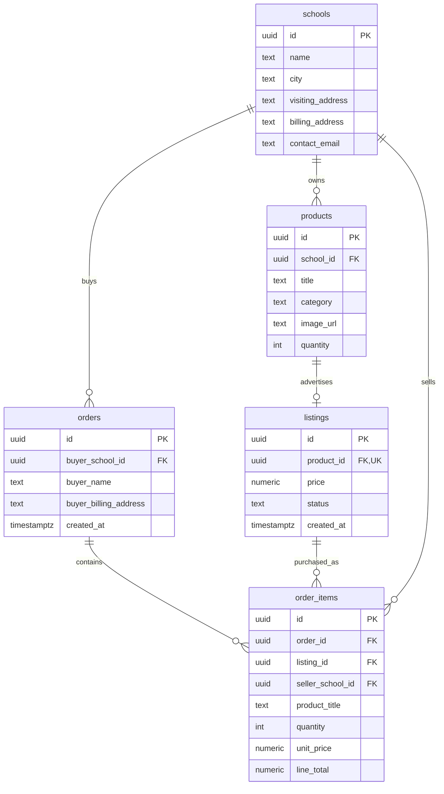

# ShopIT – databas (Anton Lindgren och Rasmus)

Databasteamet ansvarar för PostgreSQL, ER-diagram, tabeller, constraints, seed-data och överlämning. Backendteamet ansvarar för Node.js/Express, databasanslutningen, API, autentisering, behörigheter och köptransaktionerna i applikationen.

## Underlag och status

- [Uppgiftens specifikation](https://docs.google.com/document/d/1954j7vGA32ExfJ2vr5VcZzSdrLb0nRkv/edit): skolor, produkter, annonser, order, orderrader, inventarie, minst fem annonser och 30 dagars livslängd.
- [Databaskort i Trello](https://trello.com/c/kcTl3R5z) och [planeringsmötet](https://trello.com/c/lmzzXC1y).
- PostgreSQL är konfigurerad i Neon-projektet `sweet-sky-05648360`, organisation `org-autumn-sound-89853293`, branch `production`, för demon med högst cirka 15 testare. Schema och seed är installerade. Webbappens backend är ännu inte inkopplad.
- Befintlig Trello-plan: publicering 3 november, sluttest 4 november, presentationsförberedelse 5 november. Specifikationen anger slutpresentation 6 november 2026. Delmål är teamets planering, inte lärarnas föreskrivna deldeadlines.
- Verifierat 20 oktober 2026: först i PGlite, sedan i den isolerade Neon-branchen `codex-shopit-database-check`. Alla tre SQL-filer passerade på testbranchen. Därefter kördes schema och seed mot production. Produktionskontrollen visade 3 skolor, 7 produkter, 6 aktiva annonser och 0 order. Samtidiga backend-köp är ännu inte verifierade.
- Uppföljning i Trello: [Neon-konfiguration](https://trello.com/c/fsKCNCZy) och [överlämning/integrationstest](https://trello.com/c/E7IDnfWb), i listan Databas.

## Skapa databasen i Neon

Projektet ovan är redan konfigurerat. Stegen nedan beskriver uppsättningen för en **ny, tom databas**, inte något som ska köras om mot production. Databasverktygen avbryter om `shopit`-schemat redan finns, för att bevara befintlig data och struktur.

1. Skapa projektet **ShopIT** på Free-planen. Frankfurt är ett rimligt första val för teamet i Sverige; välj om möjligt samma region som backend.
2. Aktivera enbart **Postgres database**. Object storage, Functions, AI gateway, Realtime och Neon Auth behövs inte för denna databasleverans.
3. Öppna SQL Editor i rätt projekt/databas. Kör hela `001_schema.sql`, sedan hela `002_seed.sql`.
4. Kör `SELECT * FROM shopit.active_listings;`. En ny databas ska visa sex annonser från tre fiktiva skolor. En sjunde produkt finns endast i inventariet.
5. Kör `003_verify.sql` i en separat utvecklings-/testbranch med färsk seed-data. Det gör tillfälliga ändringar och rullar tillbaka dem. Kör inte verifieringen medan testare använder samma databas.
6. Under Connect hämtar ni anslutningsuppgifterna. Överlämna dem privat till backendteamet för serverns `DATABASE_URL`. Klistra inte in lösenord i Trello, GitHub eller chatten. Behåll TLS-inställningarna från Neon.
7. Backendteamet kopplar sin Node.js-app till databasen och verifierar `GET /products` mot vyn nedan. Frontend ska inte ha databaslösenordet.

`001_schema.sql` är en engångsmigration. Kör den inte igen mot en databas som redan har `shopit`-schemat. Lägg framtida strukturändringar i nya numrerade migrationsfiler. `002_seed.sql` kan köras igen utan att skriva över befintliga skolor, annonser eller lagersaldon. Den förnyar inte gamla annonsdatum. För en helt ny demo används en separat tom testdatabas och filerna körs i ordning; radera inte den gemensamma databasen för att återställa testdata.

Om ni använder lokal `psql` med miljövariablerna inställda, använd direktanslutningen för administration:

```powershell
psql "$env:DATABASE_URL_UNPOOLED" -v ON_ERROR_STOP=1 -f database/001_schema.sql
psql "$env:DATABASE_URL_UNPOOLED" -v ON_ERROR_STOP=1 -f database/002_seed.sql
# Endast på en separat testbranch:
psql "$env:DATABASE_URL_UNPOOLED" -v ON_ERROR_STOP=1 -f database/003_verify.sql
```

Officiell instruktion: [anslut till Neon och hantera anslutningssträngen](https://neon.com/docs/get-started/connect-neon).

## Installerade verktyg och anslutning

- **Neon CLI 8.8.0**, installerad globalt med `npm i -g neon@latest`; CLI-inloggningen slutfördes i webbläsaren.
- **Neon-postgres-plugin 2.3.0** för Codex är installerad och aktiverad på användarnivå. Den innehåller Neon-skills (inklusive `neon` och `neon-postgres`) samt MCP-servern `https://mcp.neon.tech/mcp` med OAuth. Samma installation gäller detta projekt; ingen dubblerad MCP-konfiguration eller extra API-nyckel har skapats. MCP kan behöva egen OAuth-inloggning när verktygen öppnas i en ny/uppdaterad Codex-session; någon autentiserad MCP-verktygskörning har inte gjorts i denna chatt.
- **neon.ts**, skapad av CLI: enbart Postgres används, `auth: false`, befintliga brancher ändras inte och nya icke-default-brancher får 7 dagars TTL. Postgres ingår i varje Neon-projekt och behöver ingen separat serviceflagga i filen. Den genererade policyn har bevarats.
- **.neon** är git-ignorerad och pekar fortfarande på production. `neon deploy` rapporterade att remote-konfigurationen redan matchade policyn och skrev `DATABASE_URL`, `DATABASE_URL_UNPOOLED` och `NEON_BRANCH` i **.env.local**. Varken filen eller dess värden ska publiceras.
- **.env.example** innehåller enbart platshållare. **.env.neon-validation** är en separat ignorerad fil för testbranchen; produktionsfilen ersattes inte vid testningen.
- **package.json / package-lock.json** innehåller `@neon/config`, `@neon/env`, `pg` och `dotenv`. Projektet är markerat privat. Detta paket innehåller databasverktyg, ingen frontend-build eller webbserver.
- **database/connection.mjs** ger backendteamet en pool-fabrik för Node.js som kör länge. Vanlig trafik använder den poolade `DATABASE_URL`; administration använder `DATABASE_URL_UNPOOLED`. TLS-certifikat/hostname verifieras, befintliga processvariabler har företräde och felutskrifter innehåller inga anslutningssträngar. Backendteamet behöver återanvända poolen i sin process och lägga till behörigheter innan appen publiceras.

Kommandon från projektroten:

```powershell
npm install
npm run db:status
# Endast vid första installation i en tom databas:
npm run db:migrate
# Skriver aldrig över befintlig seed-data/saldo:
npm run db:seed
```

`db:status` gör en skrivskyddad kontroll genom den poolade anslutningen. `db:verify` vägrar köras när `NEON_BRANCH=production` och ska användas på en färsk testbranch. Testbranchen skapades från production och löper ut 21 oktober 2026 kl. 14:00 (Europe/Stockholm).

```powershell
neon env pull --branch codex-shopit-database-check --file .env.neon-validation --service postgres
$env:SHOPIT_ENV_FILE = '.env.neon-validation'
npm run db:verify
npm run db:status
Remove-Item Env:SHOPIT_ENV_FILE
```

Värden som redan finns i processmiljön har företräde även över testfilen. Kontrollera branchinformationen i kommandots resultat. Verifieringsskriptet rullar tillbaka alla teständringar. Efter att testbranchen har löpt ut måste en ny testbranch skapas från production; befintligt schema ska då inte installeras igen.

### Verifierat resultat

```text
neon deploy
No changes — branch production already matches the policy.
Utilized services: Postgres
Pulled 3 Neon variables into .env.local

npm run db:verify  (separat testbranch)
003_verify.sql: OK (branch codex-shopit-database-check)

npm run db:status
PostgreSQL connection: OK (branch production)
ShopIT tables: listings, order_items, orders, products, schools
{"schools":3,"products":7,"active_listings":6,"orders":0}
```

Ingen `npm run build` eller end-to-end-test av webbappen har körts: detta checkout saknar ännu Node-backend och app-build, och arbetet avgränsades uttryckligen till databas/verktyg. SQL-verifieringen bevisar databasfunktionerna, inte färdiga API-, login- eller köpflöden. Databasleveransen ligger på branchen `ShopIt-Database`; granskning och merge till main återstår enligt DoD.

## ER-diagram



En färdig order ska innehålla minst en orderrad. Databasen tillåter tillfälligt en tom order medan backend bygger den i en transaktion; backend måste avbryta om ingen rad kan skapas.

## Beslut att känna till

| Område | Lösning för demon |
| --- | --- |
| Namn i SQL | Engelska tabell- och kolumnnamn under schemat `shopit`. |
| Inventarie och saldo | `products` ägs av en skola. `quantity` är kvarvarande antal och enda lagersaldot. En produkt kan finnas utan annons. |
| Annons | Högst en annons per produkt i denna demo. Annonsen erbjuder hela kvarvarande saldot. Delmängder och nypublicering efter utgång är inte implementerade. |
| Kategorier | Datorer, Laddare, Kablar, Skärmar, Switchar, Router. |
| Pengar | SEK, exakt `numeric(12,2)`, även 0 kr för bortskänkes. `pg` returnerar normalt numeric som sträng: backend ska hantera pengar utan flyttalsavrundning. |
| Tid | `timestamptz`; en annons gäller 720 timmar från skapandet. Redigering förlänger inte livslängden. |
| Aktiva annonser | Vyn `shopit.active_listings` filtrerar ut utgångna, återkallade, sålda och slutsålda annonser vid varje fråga. Backend måste även kontrollera giltigheten vid köp. |
| Radering | Sätt annonsstatus till `withdrawn` för användarens radera-flöde. Behåll historik; främmande nycklar stoppar fysisk radering av refererade poster. |
| Bilder | Endast URL/sökväg lagras. Seed använder projektets befintliga platshållarbild. Backendteamet ordnar faktisk uppladdning och lagring. |
| Fakturaunderlag | Order sparar köparuppgifter. Varje orderrad sparar produktnamn, pris, antal och säljaruppgifter vid köp. `order_totals` räknar totalsumman. PDF, fakturanummer och e-post hör till backend. |
| Flera säljare | Säljande skola ligger på orderraden så en varukorg kan innehålla flera skolors varor. Detta är demounderlag, inte ett komplett ekonomisystem. |
| Inloggning | Ingen lokal lösenordstabell. SchoolSoft-identitet → behörig skola måste backendteamet lösa; denna databas inför inte en alternativ inloggning. |

## Överlämning till backendteamet

Första gemensamma testet:

```sql
SELECT id, product_id, school_id, title, description, category,
       image_url, quantity, price, school_name, city, created_at, expires_at
FROM shopit.active_listings
ORDER BY created_at DESC, id;
```

`id` i vyn är **annonsens UUID**, vilket används för produktkort, detaljsida och köp. `product_id` är inventarieproduktens UUID. Backendteamet bestämmer API-formatet men måste bevara denna skillnad. UUID skickas som strängar. Parametrisera alla frågor (`$1`, `$2` osv.); frontend väljer aldrig fri SQL.

Inventarie per skola:

```sql
SELECT p.*, l.id AS listing_id, l.status AS listing_status
FROM shopit.products p
LEFT JOIN shopit.listings l ON l.product_id = p.id
WHERE p.school_id = $1
ORDER BY p.title;
```

`$1` för skolans behörighet kommer från verifierad server-session. Använd aldrig en skola som klienten själv anger utan behörighetskontroll. Databasens FK/constraints ersätter inte backendens åtkomstkontroll.

### Köptransaktion – backendens ansvar

Backend ska använda **en och samma databasanslutning** från BEGIN till COMMIT/ROLLBACK, även när en anslutningspool används. Skapa inte order och lagersänkning som fristående frågor på olika anslutningar.

1. Validera att varukorgen inte är tom, slå ihop upprepade annons-ID:n och kontrollera att antal är positiva heltal.
2. BEGIN. Lås alla berörda annons- och produktrader med `FOR UPDATE OF l, p`, i samma UUID-ordning för alla köp. Läs också priser och säljaruppgifter på servern.
3. Kontrollera att varje annons finns, är aktiv, inte har passerat 720 timmar och har tillräckligt saldo. Använd aktuell tid efter väntan på lås (`clock_timestamp()`), inte enbart transaktionens `now()`.
4. Skapa order med köparens faktureringsuppgifter från databasen. Kopiera säljaruppgifter, titel och aktuellt pris till orderraderna.
5. Minska saldo med en skyddad uppdatering per produkt, kontrollera att exakt en rad ändrades. Markera annonsen `sold` vid 0 kvar.
6. COMMIT bara om samtliga orderrader och saldouppdateringar lyckades. Vid fel: ROLLBACK hela köpet. Generera PDF/skicka e-post efter COMMIT; ett mailfel får inte starta ett nytt köp.

Låsfråga (`$1` är UUID-array med alla annons-ID:n):

```sql
SELECT l.id, l.product_id, l.price, l.status, l.created_at,
       p.school_id, p.title, p.quantity,
       s.name AS seller_name, s.billing_address, s.billing_reference
FROM shopit.listings l
JOIN shopit.products p ON p.id = l.product_id
JOIN shopit.schools s ON s.id = p.school_id
WHERE l.id = ANY($1::uuid[])
ORDER BY l.id
FOR UPDATE OF l, p;
```

Skyddad saldouppdatering (`$1` produkt-ID, `$2` validerat antal):

```sql
UPDATE shopit.products
SET quantity = quantity - $2
WHERE id = $1 AND $2::integer > 0 AND quantity >= $2
RETURNING quantity;
```

Noll returnerade rader betyder att hela köpet måste avbrytas. Transaktionsguiden är ett kontrakt för backendteamets implementation, inte en färdig köp-endpoint. Backendteamet behöver också hindra att samma HTTP-köp skapar dubbla order vid retry/dubbelklick.

### Gemensam verifiering före publicering

- GET /products visar minst fem annonser från Neon på testarnas länk.
- Två samtidiga köp av sista exemplaret: bara ett lyckas och bara en order sparas.
- Varukorg med två produkter där en saknar saldo: ingen del av köpet sparas.
- Pris-/skoländring efter köp ändrar inte fakturaunderlaget.
- Utgången annons syns inte och kan inte köpas via ett gammalt ID.
- En skola kan inte ändra en annan skolas annonser/inventarie.
- Återkallad annons syns inte, men tidigare orderrader finns kvar.

De samtidiga köpen och API-behörigheterna måste testas med den faktiska backendimplementationen; SQL-verifieringen ensam bevisar inte dessa flöden.
